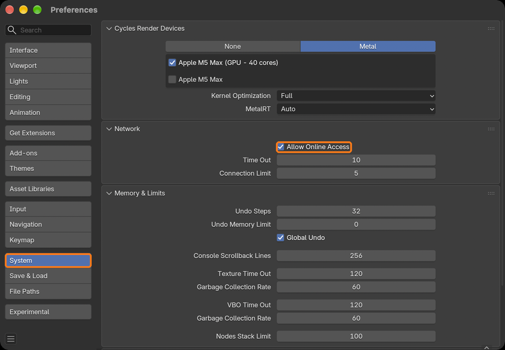
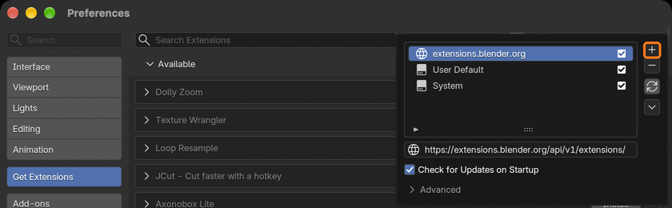
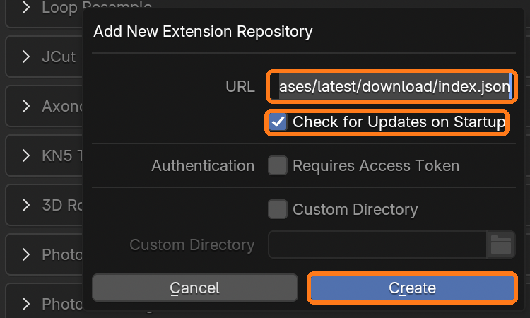
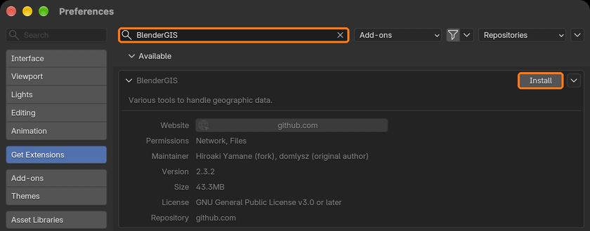
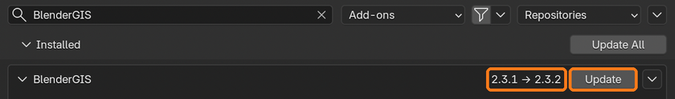
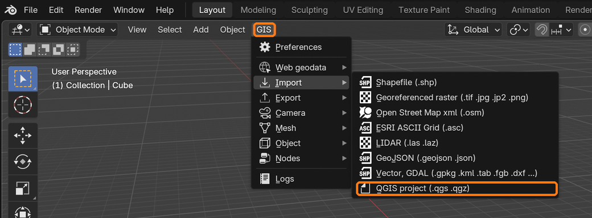
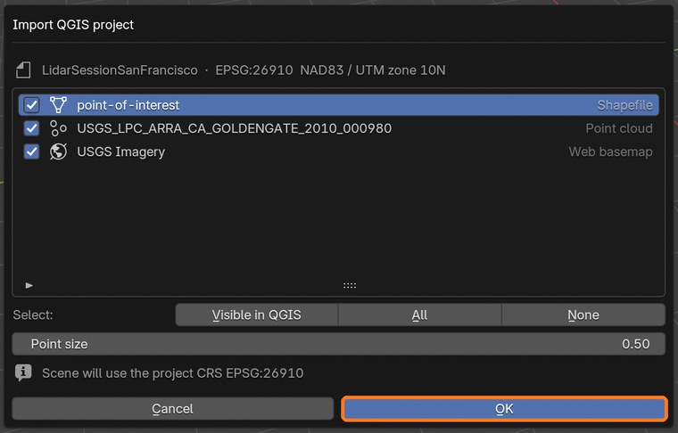
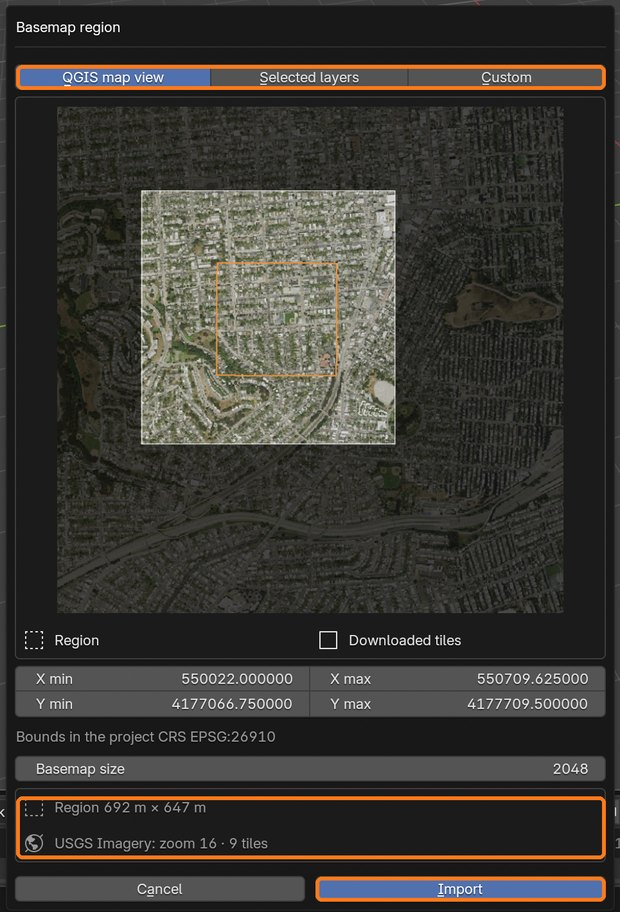
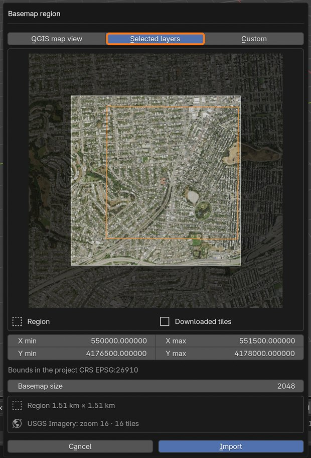
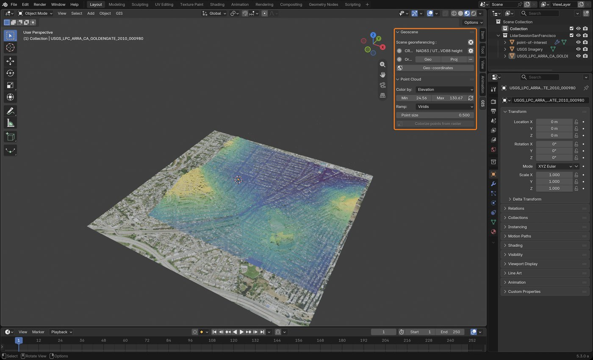

# BlenderGIS tutorial: install, update, import a QGIS project

This walks through installing BlenderGIS from its extension repository, keeping it up to date, and bringing a QGIS project (LiDAR point cloud, vector layer and aerial imagery basemap) into Blender.

Requires Blender 4.3 or newer. The screenshots are from Blender 5.3 on macOS: menus are the same on Windows and Linux.

- [1. Allow online access](#1-allow-online-access)
- [2. Add the BlenderGIS repository](#2-add-the-blendergis-repository)
- [3. Install BlenderGIS](#3-install-blendergis)
- [4. Update BlenderGIS](#4-update-blendergis)
- [5. Import a QGIS project](#5-import-a-qgis-project)
- [6. Choose the basemap region](#6-choose-the-basemap-region)
- [7. Explore the result](#7-explore-the-result)

## 1. Allow online access

Blender needs network access to read the repository and download basemap tiles.

Open *Edit > Preferences*, go to *System*, and in the *Network* panel tick **Allow Online Access**.



## 2. Add the BlenderGIS repository

Go to *Get Extensions*, click **Repositories** at the top right, then the **+** button and choose **Add Remote Repository**.



Paste this URL:

```
https://github.com/mnmly/BlenderGIS/releases/latest/download/index.json
```

Tick **Check for Updates on Startup** (it is off by default, without it new releases are not shown), then click **Create**. The repository appears as *github.com* in the list.



## 3. Install BlenderGIS

Search *BlenderGIS* in *Get Extensions* and click **Install**. Blender picks the build for your platform (Windows, macOS Intel or Apple Silicon, Linux), with all its Python dependencies.



Already installed BlenderGIS from a zip with *Install from Disk*? Uninstall it first, restart Blender, then install it from the repository: only extensions installed from a repository get updates.

## 4. Update BlenderGIS

When a new release is out, *Get Extensions* shows the new version next to BlenderGIS: click **Update** (or *Update All*).



**Restart Blender after updating.** The update can replace the bundled libraries (pyproj, GDAL) while the old ones are still loaded: coordinate reprojections fail, or Blender can crash, until Blender is restarted. The same goes for reinstalling BlenderGIS, or disabling and enabling it again. Since 2.3.3, BlenderGIS detects it and shows *Restart Blender to finish installing BlenderGIS*, and its menu reads *GIS: restart*.

## 5. Import a QGIS project

The BlenderGIS tools are in the **GIS** menu of the 3D viewport header, and in the **GIS** tab of the sidebar (*N*).

Choose *GIS > Import > QGIS project (.qgs .qgz)* and select the project file.



The dialog lists the layers of the project. The layers visible in QGIS are selected; unsupported layers are greyed out with the reason. The scene takes the CRS of the project, or the UTM zone of the map view when the project CRS is in degrees, like EPSG:4326 (in an already georeferenced scene, the layers are reprojected to its CRS instead). Click **OK**.



## 6. Choose the basemap region

When web basemap (XYZ) layers are selected, the **Basemap region** dialog opens before importing. It sets which area of the basemap is downloaded:

- **QGIS map view**: the area the QGIS map window showed when the project was last saved.
- **Selected layers**: the extent of the other selected layers, e.g. the LiDAR tile.
- **Custom**: type the bounds in the project CRS. Editing any bound switches to Custom.

The preview shows the region (orange outline) and the tiles that will be downloaded (bright area: tiles are whole, so it is larger than the region, especially when the basemap has no finer zoom level, like the USGS imagery here which stops at zoom 16). Below, the size of the region and, for each basemap, the zoom level and tile count. *Basemap size* is the maximum size in pixels of the downloaded image: larger means a sharper basemap and more tiles. After *Import*, the tiles download in the background: Blender stays usable, the status bar shows the progress and *Esc* cancels the import. The layers are imported once the download is done. If the basemap server cannot be reached, the preview and the import say so instead of showing a grey image.

Blender does not redraw dialogs on its own: move the mouse over the dialog to show the preview once it is downloaded.



With *Selected layers*, the basemap covers the LiDAR tile:



Click **Import**.

## 7. Explore the result

The layers are imported in a collection named after the project, with sub collections for the QGIS groups. The basemap is draped on a plane under the other layers (switch the viewport to *Material Preview* to see it).

Select the point cloud and open the **GIS** tab of the sidebar: the *Point Cloud* panel colors the points by RGB, elevation, intensity, classification or any other attribute, and sets the point size. The *Geoscene* panel shows the scene CRS and origin.



---

Example data: [USGS 3DEP](https://www.usgs.gov/3d-elevation-program) LiDAR (ARRA Golden Gate 2010) and [USGS National Map](https://basemap.nationalmap.gov/arcgis/rest/services/USGSImageryOnly/MapServer) orthoimagery, both public domain. To use the same basemap in QGIS, add an *XYZ Tiles* connection with the URL `https://basemap.nationalmap.gov/arcgis/rest/services/USGSImageryOnly/MapServer/tile/{z}/{y}/{x}` and a maximum zoom level of 16.
